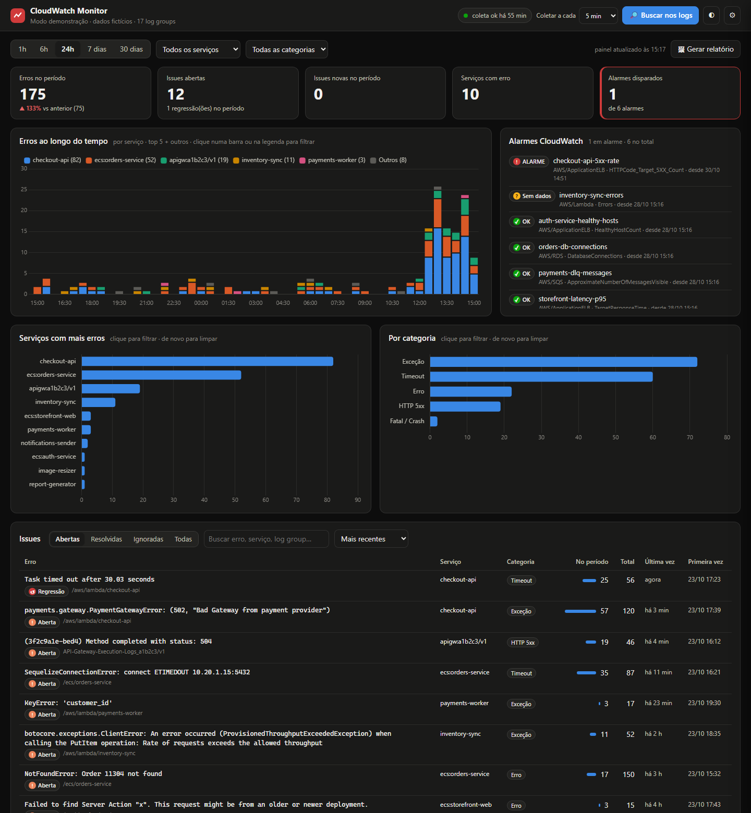
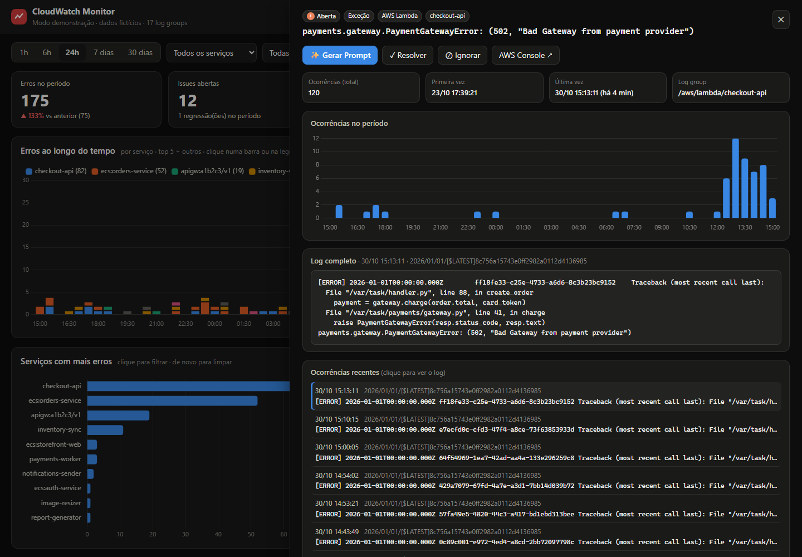
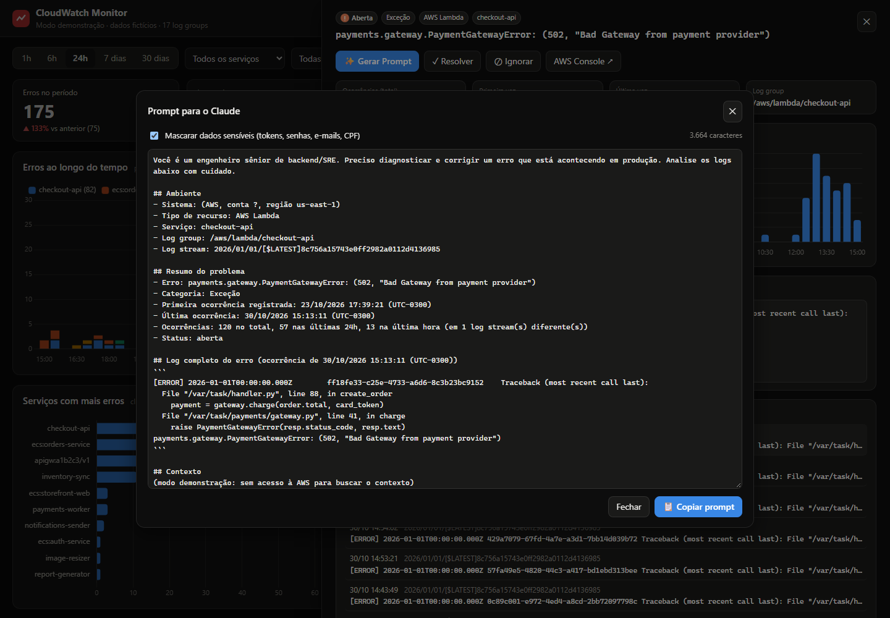
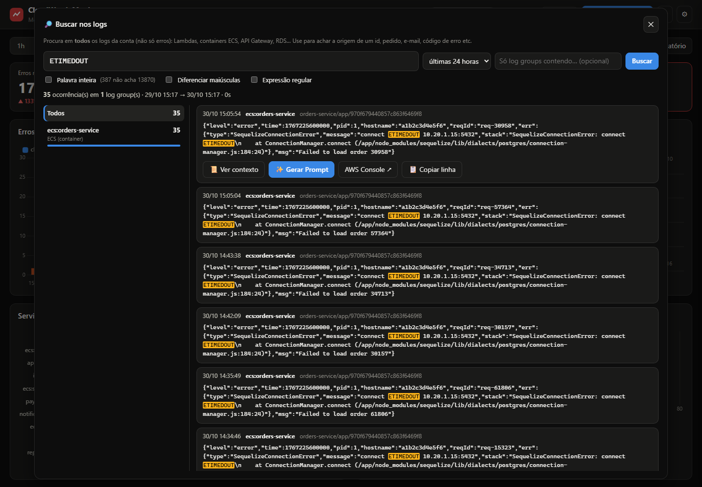
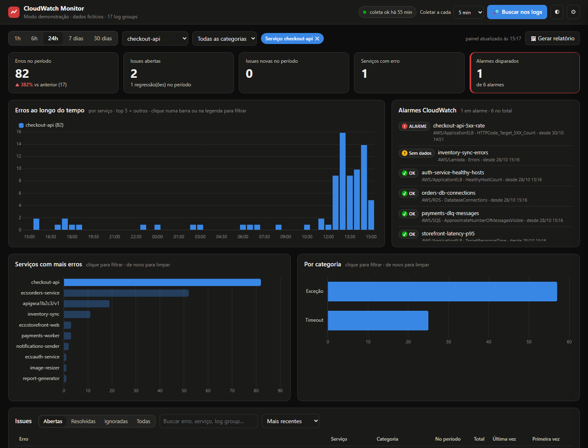
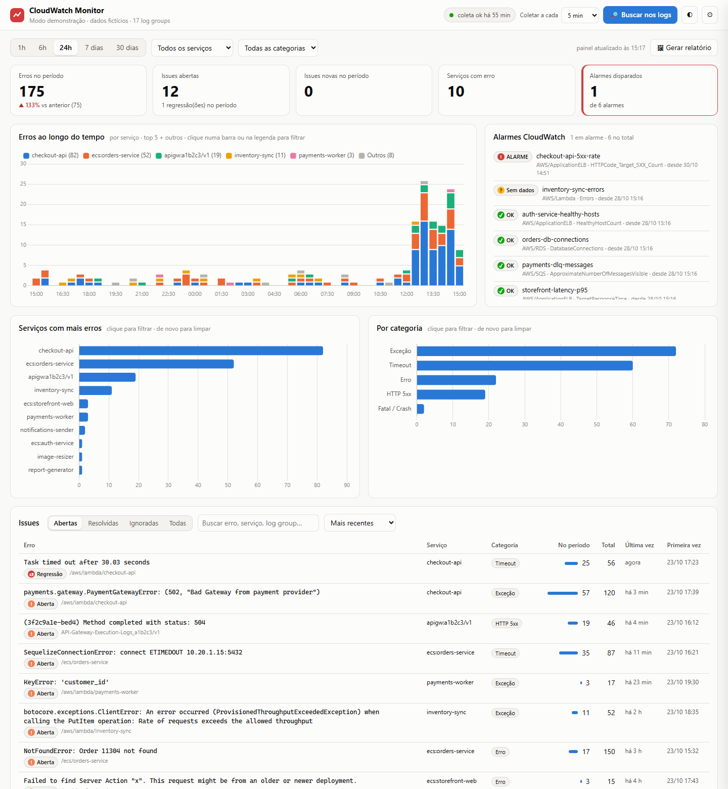
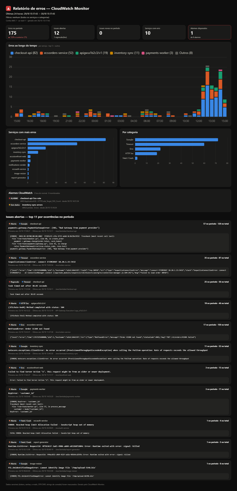

<div align="center">

# 📈 CloudWatch Monitor

**A lightweight, local error dashboard for AWS CloudWatch — a free alternative to Datadog for tracking errors.**

Runs on your machine · reads your CloudWatch logs every few minutes · groups errors into issues ·
charts, alerts, full-text log search, PNG reports and a **✨ Generate Prompt** button that hands the
full error context to Claude (or any LLM) for diagnosis.

[](LICENSE)


🇺🇸 English · [🇧🇷 Português](README.pt-BR.md)



</div>

---

## Why

Paying for a full observability platform just to *see the errors* in your Lambdas and containers is
overkill for many teams. CloudWatch already has the logs — it just doesn't make them easy to watch.

CloudWatch Monitor turns your existing CloudWatch Logs into an error dashboard you can leave open on a
second screen. **Nothing is installed in AWS**, there's no server to host, and it only needs
**read-only** credentials.

> 🔒 **Your data never leaves your machine.** No external servers, no telemetry, no analytics, no
> sign-up. The only network connection the monitor makes is to the **AWS API, in your own account**,
> to read your logs. See [Privacy](#-privacy--your-data-stays-with-you).

## Features

| | |
|---|---|
| 🔄 **Automatic collection** | Every N minutes (1–60, configurable live) via CloudWatch Logs Insights across **all** log groups — Lambda, ECS, API Gateway, RDS, Glue… |
| 🧩 **Smart grouping** | Similar errors become one **issue** (ids, numbers and timestamps ignored). Understands Python tracebacks split across lines, JSON logs (pino, structlog…), HTTP 5xx and timeouts |
| 📊 **Interactive charts** | Errors over time by service, top services, categories. Click a bar or legend to filter; period from 1h to 30 days |
| 🚨 **CloudWatch alarms** | Shows the state (OK / ALARM / no data) of the alarms already in your account |
| ✨ **Generate Prompt** | Builds a ready-to-paste diagnosis prompt: full error, the **entire Lambda invocation** (or surrounding container lines), stats and related errors. Secrets masked by default |
| 🔎 **Search** | Instant, free search in the full text of collected errors — or, with one checkbox, in **every** log line on AWS to find where an order id, e-mail or error code came from |
| 🖼 **PNG report** | One click exports KPIs, charts, alarms and top errors with messages — great for chat or tickets |
| 🔔 **Notifications** | Desktop notification for new issues and regressions |
| ✅ **Workflow** | Resolve (reopens as *Regression* if it comes back) or Ignore (known noise) |
| ⏪ **Gap recovery** | Was the app closed? Up to 24h is recovered automatically; longer gaps ask what to fetch — and run in the background |
| 🧙 **Zero-config setup** | `iniciar.bat` / `iniciar.sh` checks and installs Python, dependencies and the AWS CLI, then a console wizard configures credentials (even without the AWS CLI) |
| 🧪 **Demo mode** | `python app.py --demo` — try everything with fictional data, no AWS account needed |

## Screenshots

| Issue detail | Generate Prompt |
|---|---|
|  |  |
| **Log search** | **Filtered view** |
|  |  |
| **Light theme** | **PNG report** |
|  |  |

> All screenshots come from the built-in **demo mode** (a fictional store) — no real data.

---

## Quick start

```bash
git clone https://github.com/Saulorj/claudeWatch.git
cd claudeWatch
```

| OS | Run |
|---|---|
| **Windows** | double-click **`iniciar.bat`** |
| **macOS / Linux** | `./iniciar.sh` |

The launcher does everything, explaining each step:

1. **Python 3.10+** — checks the version; installs it if missing (winget / Homebrew / apt, dnf, pacman, zypper).
2. **Dependencies** — checks and installs `requirements.txt` (only `boto3`).
3. **AWS CLI** — optional (only needed for SSO login); offers to install it.
4. **Setup wizard** — first run only (see below).
5. Opens the dashboard at **http://127.0.0.1:8765/**

### Just want to look around?

```bash
python app.py --demo
```

Opens the dashboard with a fictional store full of realistic errors. No AWS account required.

---

## The setup wizard

Runs automatically on the first launch (or anytime with `python configurar.py`) and saves the answers
to a local **`.env`** file.

**1. AWS access** — pick one:

| Option | When |
|---|---|
| Use an existing profile | lists every AWS CLI profile found on the machine |
| **Register an access key** | most common. Paste the *Access Key ID* and *Secret*; the wizard writes the profile to `~/.aws` (same as `aws configure`). **No AWS CLI needed** |
| SSO / IAM Identity Center | installs the AWS CLI if needed and opens the browser login |
| Environment variables | `AWS_ACCESS_KEY_ID` / `AWS_SECRET_ACCESS_KEY` already set |
| “I don't have a key” | step-by-step guide for the AWS console + saves the IAM policy to `iam-policy.json` for your admin |

**2. Connection test** — connects right away and shows the account and how many log groups were found.
If something fails, it explains why and offers a fix: SSL errors caused by antivirus/corporate proxies
are **fixed automatically on Windows**; expired SSO sessions can re-login; missing permissions are
explained; wrong keys or region can be changed and retested.

**3. Preferences** — dashboard name, company/system name (used in prompts), collection interval,
first-run lookback, local history retention, which log groups to watch, and the port.

---

## Requirements

| | |
|---|---|
| OS | Windows 10/11, macOS or Linux, with internet access |
| AWS | an account with CloudWatch Logs |
| Credentials | **read-only** (access key, existing profile or SSO) |
| Python | 3.10+ (installed by the launcher if missing) |
| AWS CLI | optional (SSO only) |

No database server, Docker or Node.js — SQLite ships with Python, and the chart library (Chart.js) is bundled in the project.

### IAM permissions

Attach the AWS managed policy **`CloudWatchReadOnlyAccess`**, or this minimal policy:

```json
{
  "Version": "2012-10-17",
  "Statement": [
    {
      "Sid": "CloudWatchMonitorReadOnly",
      "Effect": "Allow",
      "Action": [
        "logs:DescribeLogGroups",
        "logs:StartQuery",
        "logs:GetQueryResults",
        "logs:StopQuery",
        "logs:GetLogEvents",
        "cloudwatch:DescribeAlarms",
        "sts:GetCallerIdentity"
      ],
      "Resource": "*"
    }
  ]
}
```

**Creating an access key (for your AWS admin):** IAM → Users → *Create user* (no console access) →
attach the policy above → *Security credentials* → *Create access key* → use case
*Application running outside AWS* → copy the Access Key ID and Secret (shown only once).

### Cost

CloudWatch Logs Insights charges **US$ 0.005 per GB scanned**. For accounts with tens of MB of logs per
day, collecting every 5 minutes costs **cents per month**. A manual 30-day search on a large account may
cost a few cents.

---

## Configuration (`.env`)

Created by the wizard; can be edited by hand (commented template: [`.env.example`](.env.example)).
Real environment variables take precedence.

| Variable | Default | Purpose |
|---|---|---|
| `MONITOR_AWS_PROFILE` | `AWS_PROFILE` or default credentials | AWS CLI profile |
| `MONITOR_AWS_REGION` | profile region, else `us-east-1` | region of your logs |
| `MONITOR_CA_BUNDLE` | — | extra `.pem` for antivirus/proxy HTTPS inspection |
| `MONITOR_APP_NAME` | `CloudWatch Monitor` | name shown in the UI and reports |
| `MONITOR_SYSTEM_NAME` | — | company/system name used in prompts |
| `MONITOR_INTERVAL_MIN` | `5` | initial collection interval (minutes) |
| `MONITOR_FIRST_LOOKBACK_HOURS` | `6` | hours fetched on the first collection |
| `MONITOR_RETENTION_DAYS` | `30` | days of local history |
| `MONITOR_GROUP_INCLUDE` | — (all) | regex: only watch matching log groups |
| `MONITOR_GROUP_EXCLUDE` | warmup, containerinsights… | regex: ignored log groups |
| `MONITOR_PORT` | `8765` | dashboard port |
| `MONITOR_DB` | user data folder | SQLite database path |

Collection values are only the **initial** ones — afterwards, use **⚙ Settings** in the dashboard.

**Several AWS accounts?** Clone the project once per account, each with its own `.env`
(different `MONITOR_PORT` and `MONITOR_DB`).

| OS | Default database location |
|---|---|
| Windows | `%LOCALAPPDATA%\cloudwatch-monitor\monitor.db` |
| macOS | `~/Library/Application Support/cloudwatch-monitor/monitor.db` |
| Linux | `~/.local/share/cloudwatch-monitor/monitor.db` |

It lives outside the project folder on purpose: OneDrive, Dropbox and iCloud lock or corrupt SQLite
files in use.

---

## Search

The 🔎 button (or the `/` key) opens the search, with two scopes:

| Scope | Where | Speed | Cost |
|---|---|---|---|
| **Collected errors** (default) | full text of the errors stored locally + service/log group name | instant | free |
| **All logs (AWS)** — checkbox | **every** log line of every log group, via Logs Insights | 5 s – 2 min | ~US$ 0.005 per GB scanned (a warning is shown) |

Each result has **Open issue**, **View context** (the whole Lambda invocation or surrounding lines),
**✨ Generate Prompt**, AWS Console link and copy. Options: period, log-group filter, whole word,
case-sensitive and regex.

## 🔒 Privacy — your data stays with you

**No information is sent to any external server.** Concretely:

| | |
|---|---|
| 🚫 **No third-party servers** | no backend, no telemetry, no analytics, no tracking, no crash reports, no account or sign-up |
| ☁️ **Only your own AWS** | the monitor's single network destination is the **AWS API of your account**, with your credentials, to *read* logs and alarms (read-only — it never writes to AWS) |
| 💻 **Everything local** | the dashboard is served from `127.0.0.1` (not reachable from the network); every file it loads — including the chart library — comes from the project folder, no CDN |
| 🗄️ **Data on your disk** | collected errors live in a SQLite file in your user folder (see the database location table above) |
| 🔑 **Credentials untouched** | they stay in the standard `~/.aws` files; the project only stores the *profile name* (`.env`, git-ignored) |
| 🤖 **No AI calls** | nothing is ever sent to Claude or any LLM — a prompt only leaves your machine if **you** copy and paste it. Tokens, passwords, e-mails, CPF/CNPJ and connection strings are masked by default |

The only other network access happens **once, at install time**: the launcher may download Python,
`boto3` (PyPI) and the AWS CLI from their official sources (winget, Homebrew, your Linux package
manager, awscli.amazonaws.com). No data of yours is sent. Clicking an *AWS Console* link simply opens
the AWS console in your browser.

### Security

- CSRF protection: the local API rejects requests coming from other websites.
- Read-only IAM policy; prefer a dedicated IAM user or SSO, and rotate keys.
- Repository protected with secret scanning + push protection and Dependabot.

## Start with your computer (optional)

- **Windows** — `Win + R` → `shell:startup` → create a shortcut to `iniciar.bat` (Run: *Minimized*).
- **macOS** — a LaunchAgent running `iniciar.sh --no-browser` (example in the
  [Portuguese README](README.pt-BR.md#iniciar-junto-com-o-computador-opcional)).
- **Linux** — a `systemd --user` service running `iniciar.sh --no-browser` (same link).

Run the launcher manually once first so the wizard can create the `.env`.

## Troubleshooting

| Symptom | Fix |
|---|---|
| “Could not access AWS” on startup | run `python configurar.py` — it tests and tells you what to fix (`python app.py --check` only tests) |
| `SSL: CERTIFICATE_VERIFY_FAILED` | antivirus/proxy inspecting HTTPS: run `python configurar.py` (auto-fix on Windows) or set `MONITOR_CA_BUNDLE` |
| `AccessDenied` | missing permissions — see *IAM permissions* |
| Expired SSO session | `aws sso login --profile YOUR_PROFILE` |
| Port in use | change `MONITOR_PORT` in `.env` |
| Empty dashboard | wait for the first collection (“collection ok” at the top) or widen the period |
| Linux: `ensurepip is not available` | `sudo apt install python3-venv` (the launcher offers it) |

## How it works

Every interval the collector runs **CloudWatch Logs Insights** queries over all log groups (50 per
query), filtered by an error regex you can edit. Windows overlap by 3 minutes to catch late-ingested
logs; duplicates are dropped. Multi-line tracebacks are merged and fetched in full from the log stream;
INFO/DEBUG lines are ignored unless they signal a 5xx or a timeout. JSON logs have the error type and
message extracted as the title. Similar errors become an issue (Timeout / HTTP 5xx / Fatal /
Exception / Error), stored in SQLite and served by a small standard-library HTTP server.

```
iniciar.bat / iniciar.sh   launchers (requirements check + wizard + start)
configurar.py              setup wizard  →  .env
app.py                     local HTTP server + API  (--demo, --check, --port, --no-browser)
collector.py               Logs Insights collection, alarms, gap recovery, search
fingerprint.py             error classification and grouping
prompt.py                  prompt builder (with secret masking)
demo.py                    fictional data for demo mode
db.py · config.py          SQLite schema · configuration
web/                       dashboard (vanilla HTML/CSS/JS + bundled Chart.js, MIT)
```

## Contributing

Issues and pull requests are welcome. The project is maintained on a best-effort basis.

## License

[MIT](LICENSE) © Saulo Oliveira

---

<sub>Not affiliated with, endorsed by or sponsored by Amazon Web Services or Anthropic. “AWS” and
“CloudWatch” are trademarks of Amazon.com, Inc.; “Claude” is a trademark of Anthropic, PBC — used here
only to describe compatibility.</sub>
